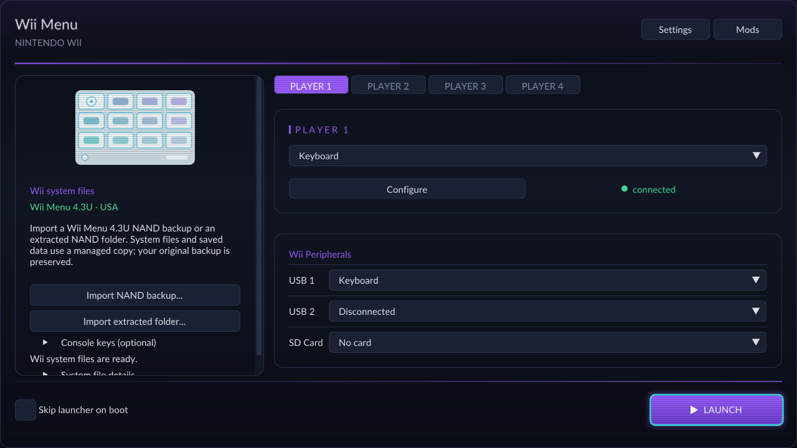
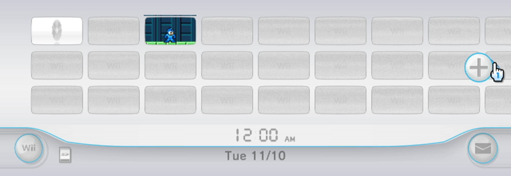

# Wii Menu Recomp

The Wii Menu as a native desktop application, with its own startup launcher,
system-data import, controller assignments and peripheral settings. This
repository owns the Menu's presentation and release configuration and pins the
[wiillr engine](https://github.com/mstan/wiillr) as a Git submodule.

Provide your own supported Wii Menu 4.3U NAND backup or extracted system folder.
Firmware, console keys, installed channel content and generated guest code are
external inputs. Preserve your managed NAND and per-user settings when updating.




## Adaptive Fit to screen

Enable **Adaptive channel grid (experimental)** in **Mods** and select **Fit to
screen**, then resize the window. The original three rows remain, with two
columns in portrait and up to eight in wider windows. Neighboring columns peek
through at the sides, and paging uses the original sliding animation. Channels
keep their original identities and NAND order.

The pointer, clock and bottom controls retain their proportions. Channel frames
blend with the original backdrop. Stock presentation remains available; channel
rearrangement is disabled while the adaptive mod is active. Other Menu screens
retain their original layouts. Android support is not implied.




[Setup, controls and peripherals](https://github.com/mstan/wiillr/blob/69244f5de1a203f6bcb5bf02281f1d99f5dca689/docs/wii-menu.md)
include four Wii Remote assignments, two USB ports and an SD Card slot. Keyboard
typing uses the USB keyboard peripheral independently of Wii Remote buttons.

## Local builds

```sh
git clone --recurse-submodules git@github.com:mstan/wii-menu-recomp.git
cd wii-menu-recomp
```

Use the matching native toolchain and a qualified private input bundle, described
in the engine's [build guide](https://github.com/mstan/wiillr/blob/69244f5de1a203f6bcb5bf02281f1d99f5dca689/docs/building.md).

Windows PowerShell:

```powershell
./tools/build-windows.ps1 --inputs-dir G:/wiillr-inputs --build-dir G:/wii-menu-build --output-dir G:/wii-menu-dist --jobs 2
```

Linux:

```sh
bash tools/build-linux.sh --inputs-dir /path/to/inputs --build-dir /path/to/build --output-dir /path/to/dist --jobs 2
```

macOS:

```sh
bash tools/build-macos.sh --inputs-dir /path/to/inputs --build-dir /path/to/build --output-dir /path/to/dist --jobs 2
```

`product.json` owns the product identity and default version. `tools/build.py`
selects this consumer's provider and delegates compilation to the pinned engine;
`tools/package.py` packages explicit outputs with the consumer's documentation
and required source/license notices. Builds run locally. The adaptive preview
archive is qualified on Windows x86_64; Linux and macOS scripts are provided,
with native builds and runtime qualification on those hosts still pending.

The provider is original [MIT-licensed code](LICENSE). The engine's
[Menu annotation guide](https://github.com/mstan/wiillr/blob/69244f5de1a203f6bcb5bf02281f1d99f5dca689/docs/wii-menu-references.md)
records the original-version identities and reverse-engineering references.
