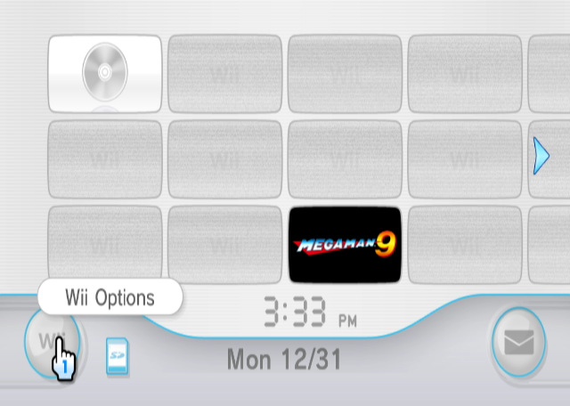

# Wii Menu Recomp

The Wii Menu as a native desktop application, with its own startup launcher,
system-data import, controller assignments and peripheral settings. This
repository owns the Menu's presentation and release configuration and pins the
[wiillr engine](https://github.com/mstan/wiillr) as a Git submodule.

Provide your own supported Wii Menu 4.3U NAND backup or extracted system folder.
Firmware, console keys, installed channel content and generated guest code are
external inputs. Preserve your managed NAND and per-user settings when updating.




## Adaptive Fit to screen

Enable **Adaptive channel grid (experimental)** in **Mods** and select **Fit to
screen**, then resize the window. The original three rows remain, with two
columns in portrait and up to eight in wider windows. Neighboring columns peek
through at the sides, and paging uses the original sliding animation. Channels
keep their original identities and NAND order.

The pointer, clock and bottom controls retain their proportions. Channel frames
blend with the original backdrop. Stock presentation remains available; channel
rearrangement is disabled while the adaptive mod is active. Other Menu screens
retain their original layouts. Android support is not implied.


[Setup, controls and peripherals](https://github.com/mstan/wiillr/blob/11c3d06111a878a172ea98430173d4bdc067e277/docs/wii-menu.md)
include four Wii Remote assignments, two USB ports and an SD Card slot. Keyboard
typing uses the USB keyboard peripheral independently of Wii Remote buttons.

## Run the Windows preview

Download the Windows archive from [Releases](https://github.com/mstan/wii-menu-recomp/releases),
extract the complete archive and open **Wii Menu**. Import your supported NAND
backup or extracted system folder in the launcher. The source-build arguments
below are not needed to run the downloaded application.

## Local builds

```sh
git clone https://github.com/mstan/wii-menu-recomp.git
cd wii-menu-recomp
git submodule update --init wiillr
```

These are maintainer source-build commands. The generated-code input bundle is
private; a public clone and a NAND backup alone do not currently supply it.
Use the matching native toolchain and qualified build inputs described in the
engine's [build guide](https://github.com/mstan/wiillr/blob/11c3d06111a878a172ea98430173d4bdc067e277/docs/building.md).

Windows PowerShell:

```powershell
./tools/build-windows.ps1 --inputs-dir "C:/wii-build-inputs" --build-dir build/windows-x86_64 --output-dir dist --jobs 2
```

Linux:

```sh
bash tools/build-linux.sh --inputs-dir /path/to/wii-build-inputs --build-dir build/linux-x86_64 --output-dir dist --jobs 2
```

macOS:

```sh
bash tools/build-macos.sh --inputs-dir /path/to/wii-build-inputs --build-dir build/macos --output-dir dist --jobs 2
```

The consumer selects the product automatically. Its version defaults to the
value in `product.json`; `--version 0.1.1-local.1` is an optional package-label
override, unrelated to Wii Menu 4.3U. `--inputs-dir` points to the verified
developer bundle containing `inputs.json`, sources and the qualified catalog.
It does not point to a NAND or game folder.

`--build-dir` holds compiler working files; `--output-dir` receives finished
archives. **Both paths are currently required.** The `build/...` and `dist`
paths above are explicit examples, not automatic defaults. The engine's
[argument reference](https://github.com/mstan/wiillr/blob/11c3d06111a878a172ea98430173d4bdc067e277/docs/building.md#build-arguments)
defines valid products, inputs, versions and common errors.

`product.json` owns the product identity and default version. `tools/build.py`
selects this consumer's provider and delegates compilation to the pinned engine;
`tools/package.py` packages explicit outputs with the consumer's documentation
and required source/license notices. Builds run locally. The adaptive preview
archive is qualified on Windows x86_64; Linux and macOS scripts are provided,
with native builds and runtime qualification on those hosts still pending.
Windows qualification applies to the published archive. A fresh end-to-end
adaptive-preview rebuild through these wrappers with a matching release-specific
input bundle has not been qualified.

The provider and consumer build scripts use [GPLv3 or later](LICENSE).
[Licensing details](LICENSING.md) preserve upstream terms and earlier grants. The engine's
[Menu annotation guide](https://github.com/mstan/wiillr/blob/11c3d06111a878a172ea98430173d4bdc067e277/docs/wii-menu-references.md)
records the original-version identities and reverse-engineering references.
